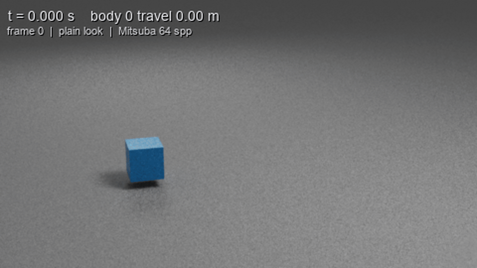
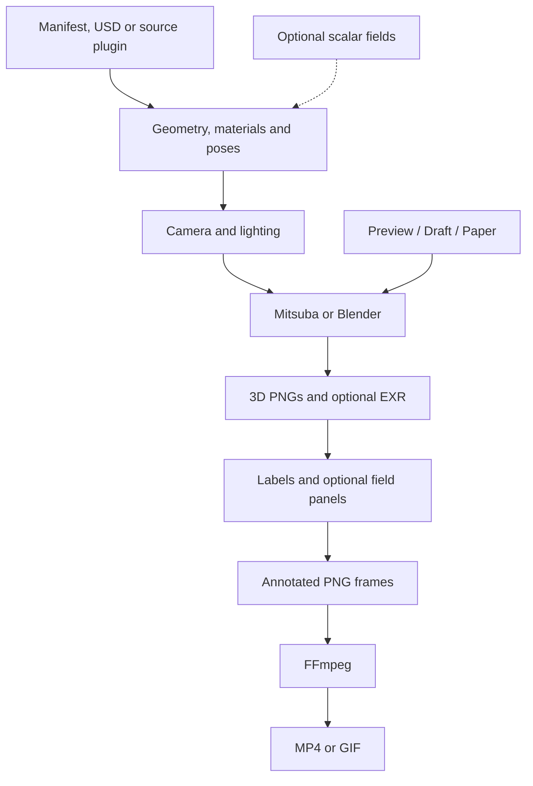

# MistubaVideo

[](https://github.com/ETSim/MistubaVideo/actions/workflows/mitsuba-video.yml)
[](packages/mitsuba_video/pyproject.toml)
[](https://pypi.org/project/mitsuba/)
[](LICENSE)

Render 3D frames with Mitsuba 3, inspect the PNGs, then encode them as a video. Use manifests from your project, OpenUSD stages, or installed source plugins. Scalar fields and material transitions are optional.



The cube toss uses plain materials and a prescribed ballistic path. [View the frame strip](docs/images/cube-throw.png). Recreate both with `python examples/render_readme.py --animate` after installation.

## Rendering workflow



## Install

Python 3.10 or newer is required for `mitsuba-video`. The older `main.py` application requires Python 3.11 or newer. Install FFmpeg to encode MP4 or GIF output.

```bash
git clone https://github.com/ETSim/MistubaVideo.git
cd MistubaVideo
python -m venv .venv
# Windows PowerShell: .venv\Scripts\Activate.ps1
# Linux/macOS: source .venv/bin/activate
python -m pip install --upgrade pip
python -m pip install ".[usd,notebook]"
mitsuba-video doctor
```

With uv, use `uv venv` and `uv pip install ".[usd,notebook]"`, then activate the environment. The core has no simulator or HDF5 dependency. Source adapters are installed as plugins.

For the portable Windows application, see [pip and EXE installation](docs/install.md). Extract its ZIP and run
`mitsuba-video.exe`; keep the adjacent `_internal` folder. Build it locally with `python examples/build_executable.py`
after installing `.[freeze]`, or download the Windows workflow artifact. Python is bundled in that application.

## Render your first frames

```bash
mitsuba-video fixture output/demo --kind cube-throw --frames 24
mitsuba-video inspect output/demo
mitsuba-video render output/demo -q preview --look plain --no-panel --no-chart --no-encode
```

Open `output/demo/render_plain/beauty/` for the 3D images or `frames/` for frames with the time label. Each selected input frame produces one numbered PNG. Rendering and video encoding are separate steps:

```bash
mitsuba-video encode output/demo/render_plain --fps 40 --hold 0
mitsuba-video render output/demo -q preview --look plain --no-panel --no-chart --no-encode --resume
```

`--resume` reuses completed frames and rejects changed render settings. Keep source files unchanged between runs. Use a new output folder when changing the scene. `--frames 0:120:2` renders every second frame in the first 120; `--frames -1:` renders the last frame.

Run `mitsuba-video tui` for guided terminal setup. It shows a reusable command before rendering. `mitsuba-video doctor --variant cuda` performs a small render to check the backend and reports FFmpeg and optional input support. Long renders show frame counts, ETA and render/blend times.

## Input formats

| Input | Example | Support |
|---|---|---|
| Manifest | `mitsuba-video render path/to/manifest.json` | OBJ meshes, textures, poses and per-frame scalar fields |
| OpenUSD | `mitsuba-video render scene.usda --look plain` | `.usd`, `.usda`, `.usdc`, `.usdz`; polygon meshes and rigid transform animation |
| OBJ sequence | `python main.py multi --folder exports` | Older batch interface; install `requirements.txt` first |

USD imports stage units and the up axis, parent transforms, static scale, normals, `st` UVs and constant `UsdPreviewSurface` diffuse colour, roughness and metallic values. It samples each time code; use `-O step=2` to sample every other time code. The renderer supplies its own cameras and lights. USD does not supply wear fields. See [the USD guide](docs/usd.md) for supported features and export requirements.

## Optional fields and materials

Animations render with `--look plain` by default. For a scalar-field example:

```bash
mitsuba-video fixture output/temperature --kind temperature
mitsuba-video render output/temperature --look heatmap -q preview
mitsuba-video fixture output/damage --kind damage
mitsuba-video render output/damage --look material -q preview
```

`--look material` blends base and affected appearances with the selected field. `--look heatmap` adds a labelled
overlay. The older `worn` look and material key remain compatible. Surface shading is independent:

```bash
mitsuba-video render output/demo --shading diffuse --out output/diffuse
mitsuba-video render output/demo --shading metallic --out output/metallic
mitsuba-video render output/demo --shading ao --out output/ao
```

PBR uses albedo, roughness, tangent-space normal and metallic maps. Diffuse removes the specular lobe; metallic forces a metallic surface for appearance checks. AO casts hemisphere rays with a range of 20% of the scene bounding diagonal and shows geometric occlusion in greyscale.

Manifest `base` and `affected` appearances accept `metallic` as a value or image path and `ao` as an image path. AO textures multiply albedo in linear colour space as an artistic approximation; path tracing already calculates light transport. MTL inputs accept `map_Pm` and `map_AO`, including `_worn` variants. An affected stage can expose a different material as a field changes.

Field material interpolation supports two or four stages, scalar remapping, height shaping and spherical normal
interpolation. The source defines what each scalar value means. [Material and source API
details](packages/mitsuba_video/README.md).

`--face-normals` gives meshes a faceted appearance, matching the effect of Mitsuba's OBJ `face_normals=true`. By default, authored or computed vertex normals are interpolated. Normal maps can still add surface detail; `--normal-strength 0` flattens them for geometry comparisons.

`--displacement-scale 0.002` offsets existing mesh vertices along their normals by `0.002 * (height - 0.5)` in world units. It uses the base height map once before animation, and defaults to zero. This static displacement uses the existing mesh, with no subdivision or per-frame height updates. Use a dense mesh for silhouette detail. The notebook includes a generated height-map example.

## Quality presets

Choose a preset with `-q` or `--quality`:

| Preset | Resolution | Samples per pixel | Use |
|---|---|---:|---|
| `preview` | 960 x 540 | 16 | Check framing, motion and materials |
| `draft` (default) | 1280 x 720 | 64 | Review a sequence before the final render |
| `paper` | 1920 x 1080 | 256 | Render at full HD with more samples |

```bash
mitsuba-video render output/demo -q preview --out output/preview --no-encode
mitsuba-video render output/demo -q draft --out output/draft --no-encode
mitsuba-video render output/demo -q paper --out output/paper --no-encode
```

All three presets render every selected input frame. Add `--frames 12:13` to compare the same frame at each
quality. The separate `mitsuba-video preview` command selects every eighth input frame by default.

Override a preset's resolution or sample count with `--res` and `--spp`. For a custom 4K render:

```bash
mitsuba-video render output/demo -q paper --res 3840x2160 --spp 512 --out output/4k --no-encode
```

More pixels and samples increase rendering work. Check the noise and fine detail before rendering the whole
sequence. On NVIDIA GPUs, `--variant cuda --denoise` enables guided OptiX denoising. Denoising keeps the chosen
sample count; reduce it explicitly with `--spp` if needed.

## GPU and rendering speed

Mitsuba 3.9.x and its matching Dr.Jit dependency are installed together. `--variant auto` tries CUDA on NVIDIA, Metal on Apple Silicon, LLVM on CPU, then scalar CPU. Explicit `--variant cuda`, `metal`, `cpu` and `scalar` choices are available. The renderer tests each backend with a small render before selecting it.

The scene is built once. Unchanged poses skip geometry uploads, unchanged fields skip texture blending, and CPU blends update only changed tiles where supported. `--blend-device auto` uses CUDA for supported terms; burnish and edge-wear terms use CPU. Read `timing_s_per_frame` in `render_config.json` to see where your scene spends time. GPU rendering and GPU field blending are separate choices. Performance depends on scene size, samples, textures and hardware.

Blender is also available through `--backend cycles` or `--backend eevee` when installed. These backends save an animated `scene.blend`. Composite labels can be changed with `--annotate labels.json --resume --recompose` without rendering the beauty frames again. `--displace` retains the optional subdivided, animated height-map path; `--displacement-scale` is the simpler static option.

## Source plugins

Simulation-specific readers and options belong to external plugins. [The plugin guide](docs/plugins.md) explains entry points and the TextureFriction adapter migration. Installing the core does not install a recording reader.

## Notebook

[The tutorial notebook](notebooks/getting_started.ipynb) covers the cube toss, multiple camera views, a frame sequence, video encoding, faceted normals, minimal displacement and USD. Run `jupyter lab notebooks/getting_started.ipynb` from the repository root and select the installed environment's kernel.

[The usage guide](docs/guide.md) walks through the commands. A reusable [Codex skill](.agents/skills/mitsuba-video/SKILL.md) is included for working with this repository.

## Development

```bash
python -m pip install -e "packages/mitsuba_video[test]"
python -m pytest packages/mitsuba_video/tests -q
python -m ruff check packages/mitsuba_video
python -m build packages/mitsuba_video
```

Tests cover blend math, maps, manifests, USD animation, terminal setup, resume safety and real small renders. CI runs Linux and Windows tests and rendering checks. GPU checks skip when CUDA is unavailable. The installable package lives in `packages/mitsuba_video/`; `src/` and `main.py` retain the older OBJ application. Generated output stays under the ignored `output/` directory.

For a CPU container, use `docker compose run --rm mitsuba-renderer --help`. NVIDIA rendering additionally needs NVIDIA Container Toolkit; build the image, then run `docker run --rm --gpus all mitsuba-video doctor --variant cuda`.

The [publishing workflow](docs/publishing.md) is available for a future release. Its default run builds and checks the distribution without uploading it.

[MIT license](LICENSE)
